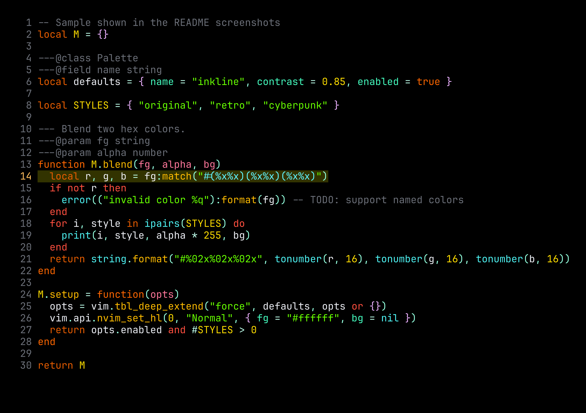
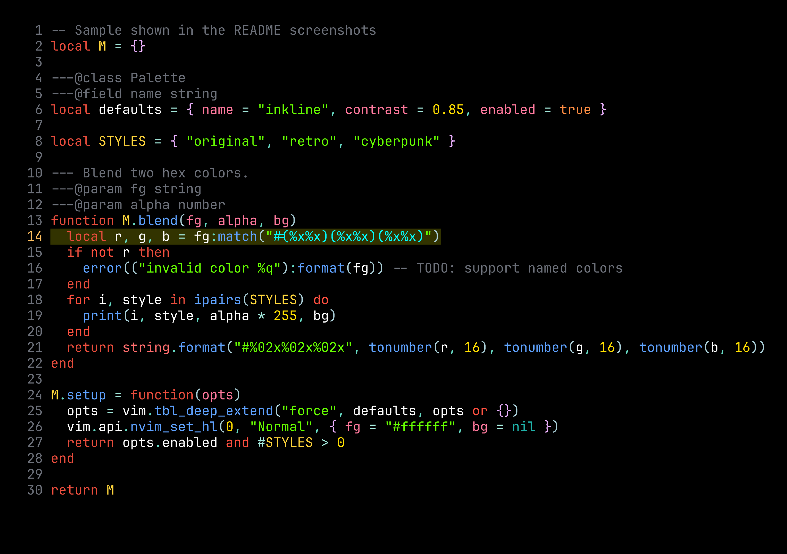
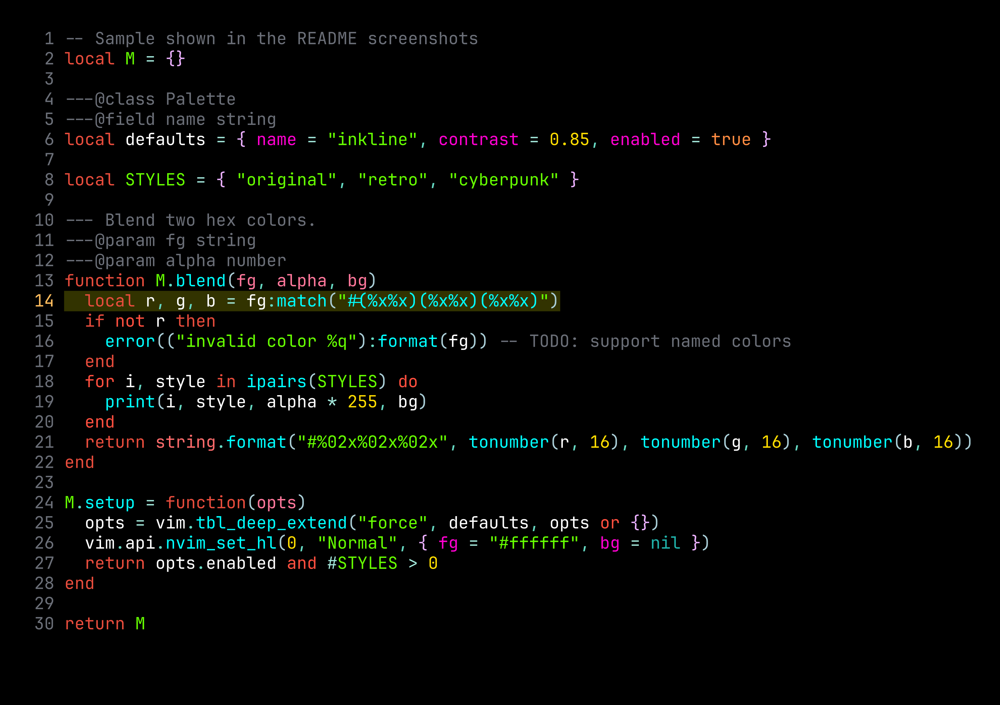

# inkline.nvim

inkline is a dark, early-2000s colorscheme for [Neovim][neovim], ported from TextMate's **vibrant-ink** theme.



## Features

- Three styles: `original`, `retro`, and `cyberpunk`
- Tree-sitter, LSP semantic token, and diagnostic highlights
- Terminal colors for `:terminal`
- Highlights for gitsigns, telescope, nvim-cmp, noice, flash, which-key, dropbar, copilot, and treesitter-context, each of which can be turned off
- lualine themes
- `:checkhealth inkline`

## Requirements

- [Neovim][neovim] 0.11 or newer
- A terminal with true color support (inkline turns on `termguicolors`)

## Installation

With [lazy.nvim](https://github.com/folke/lazy.nvim):

```lua
{
  "hectron/inkline.nvim",
  lazy = false,
  priority = 1000,
  config = function()
    require("inkline").setup({}) -- optional
    vim.cmd.colorscheme("inkline")
  end,
}
```

`setup()` is optional. It only stores options; `:colorscheme` applies them.

## Styles

| `original` | `retro` | `cyberpunk` |
| --- | --- | --- |
|  |  |  |

- `original` (default) follows TextMate's vibrant-ink.
- `retro` has light blue functions, pink properties, and warm yellow constants.
- `cyberpunk` has cyan functions, magenta properties, and green constants.

Pick a style in `setup()` and load `inkline`, or load a style directly:

```vim
colorscheme inkline           " style from setup(), default "original"
colorscheme inkline-retro
colorscheme inkline-cyberpunk
```

`require("inkline").switch_style("retro")` switches at runtime and fires `ColorScheme` like any other colorscheme.

## Options

These are the defaults:

```lua
require("inkline").setup({
  style = "original",          -- "original", "retro", or "cyberpunk"
  dim_inactive_windows = true, -- darker inactive windows; set explicitly to also dim when Neovim loses focus
  transparent = false,         -- no editor background
  purple_comments = false,     -- purple comments instead of gray
  vibrant_strings = true,      -- lime strings; false for a softer green
  terminal_colors = true,      -- set terminal_color_0..15
  plugins = { default = true }, -- plugin highlights; e.g. { flash = false }, or false for none
  on_colors = nil,             -- fun(colors): colors
  on_highlights = nil,         -- fun(highlights, colors): highlights
})
```

Plugin names for `plugins`: `cmp`, `copilot`, `dropbar`, `flash`, `gitsigns`, `noice`, `telescope`, `treesitter_context`, `which_key`.

## Customization

Change palette colors before highlights are built:

```lua
require("inkline").setup({
  on_colors = function(colors)
    colors.purple = "#ff00ff"
  end,
})
```

Change or add highlight groups. A string value links to another group:

```lua
require("inkline").setup({
  on_highlights = function(hl, c)
    hl.Comment = { fg = "#888888", italic = true }
    hl["@markup.link"] = { fg = c.yellow }
    hl["@string.special"] = "Special"
  end,
})
```

Both callbacks can modify their table in place or return a new one.

## lualine

```lua
require("lualine").setup({ options = { theme = "inkline" } })
```

`inkline` follows the style from `setup()`. `inkline-original`, `inkline-retro`, and `inkline-cyberpunk` always use their own style.

## Documentation

`:help inkline` covers options, styles, customization, and the Lua API. `:checkhealth inkline` reports invalid options, typos in option or plugin names, and whether `termguicolors` is on.

## Development

```sh
make test       # run tests (fetches mini.nvim into .tests/ on first run)
make snapshots  # accept intended highlight changes
make lint       # StyLua and lua-language-server checks
scripts/screenshots.sh  # regenerate assets/*.png (needs tmux, freeze, and perl)
```

`tests/snapshots/*.txt` records the final color of every highlight group per style. A change that alters colors shows up as a text diff there; regenerate the screenshots when it is intended.

[neovim]: https://github.com/neovim/neovim
